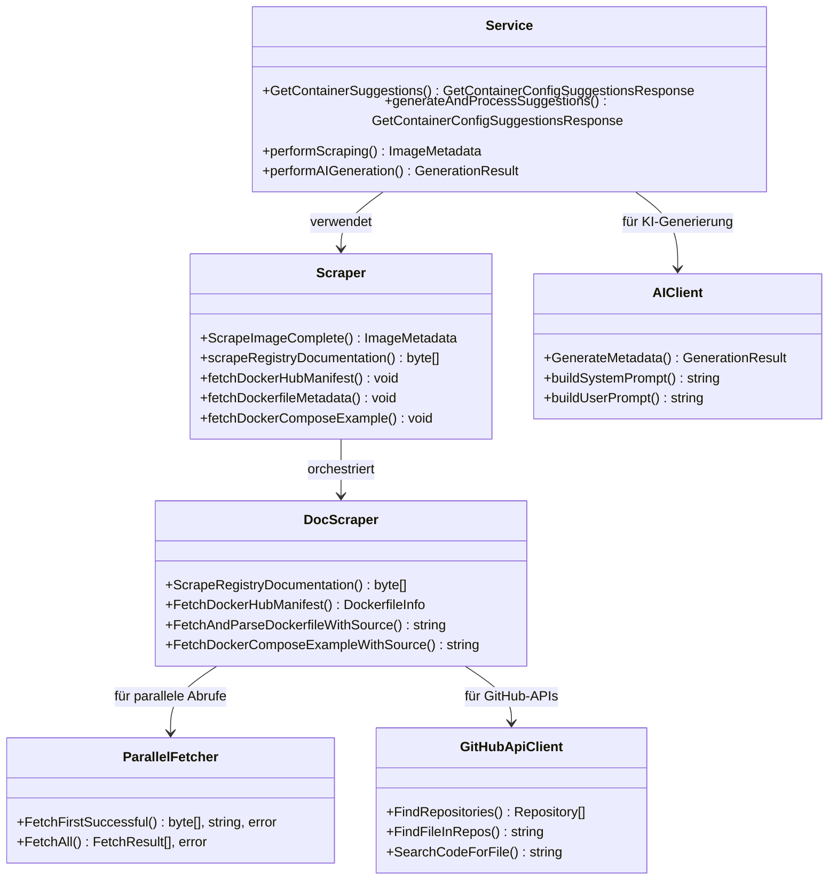

# Meerjungfraulint

A fast, state-of-the-art linter for Markdown files with Mermaid diagrams.

## Features

- Fast Rust-based linting
- Configurable rules via TOML
- Parallel file processing
- LSP server for editor integration
- Multiple output formats (text, JSON, SARIF)
- Auto-fix for safe issues
- CI/CD integration

## Installation

```bash
cargo install meerjungfraulint
```

## Usage

Lint a file:

```bash
meerjungfraulint lint path/to/file.md
```

Lint with SARIF output:

```bash
meerjungfraulint lint path/to/file.md --format sarif
```

## Configuration

Create `.meerjungfraulint.toml`:

```toml
[rules]
duplicate-node = { enabled = true, severity = "Error" }
unknown-node = { enabled = true, severity = "Error" }
naming-convention = { enabled = true, severity = "Warning" }
large-diagram = { enabled = true, severity = "Info" }
missing-edge-label = { enabled = false, severity = "Warning" }
```

## Rules

- `duplicate-node`: Detects duplicate node IDs
- `unknown-node`: Detects edges to non-existent nodes
- `naming-convention`: Enforces PascalCase for class names
- `large-diagram`: Warns on diagrams with >10 nodes
- `missing-edge-label`: Warns on unlabeled edges

## Example



## Editor Integration

### VSCode

Install the Lintjungfrau extension (placeholder).

### Neovim

Add to init.lua:

```lua
require('lspconfig').meerjungfraulint.setup{}
```

### Zed

Add to settings.json:

```json
{
  "lsp": {
    "meerjungfraulint": {
      "binary": "meerjungfraulint"
    }
  }
}
```

## Contributing

Contributions welcome! Please run tests and lint before submitting.

## License

MIT